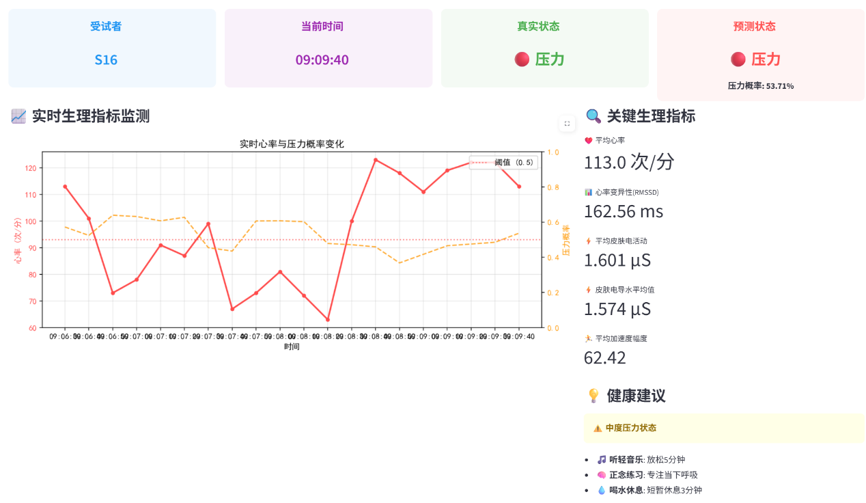
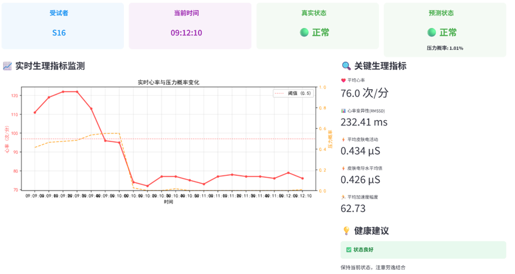
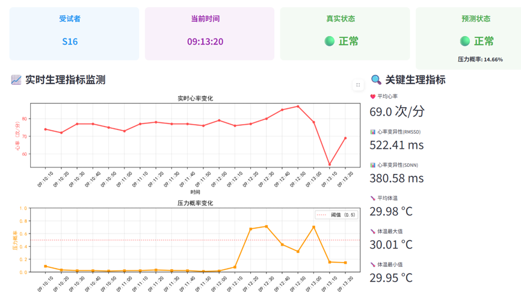

# IIEW-System

### Intelligent Identification and Early Warning System for Adolescent Stress

*A multimodal time-series data fusion system for real-time physiological monitoring, intelligent stress identification, and early warning.*

---

## Overview

**IIEW-System** analyzes multimodal physiological time-series data to identify adolescent stress states and provide real-time information.

The following screenshots demonstrate the system's real-time monitoring results for **Subject S16**.

---

## Results

### 1. Physiological Monitoring at `09:09:40`

  

  <em>Figure 1. Real-time physiological monitoring of Subject S16 at 09:09:40.</em>

---

### 2. Physiological Monitoring at `09:12:10`

  

  <em>Figure 2. Real-time physiological monitoring of Subject S16 at 09:12:10.</em>

---

### 3. Physiological Monitoring at `09:13:20`

  

  <em>Figure 3. Real-time physiological monitoring of Subject S16 at 09:13:20.</em>

---

**IIEW-System — Intelligent Stress Identification and Early Warning through Multimodal Data Fusion**

